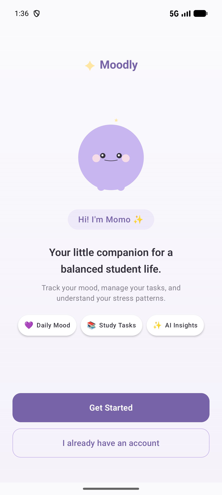
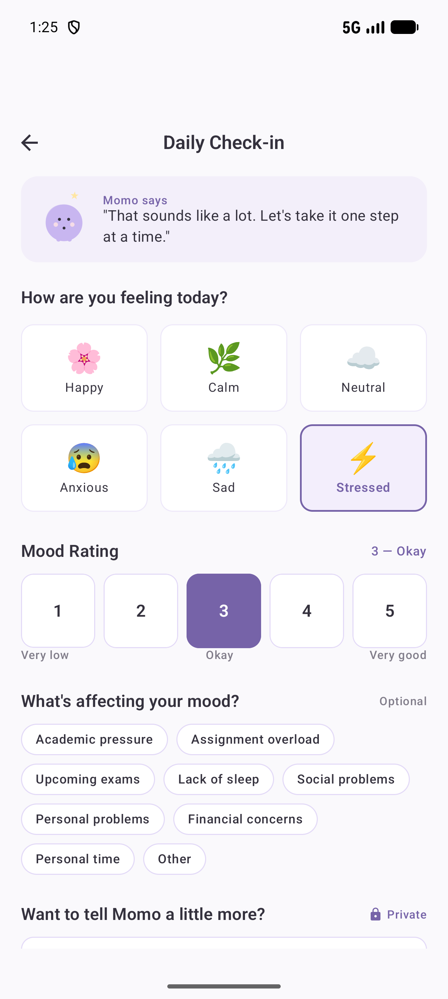
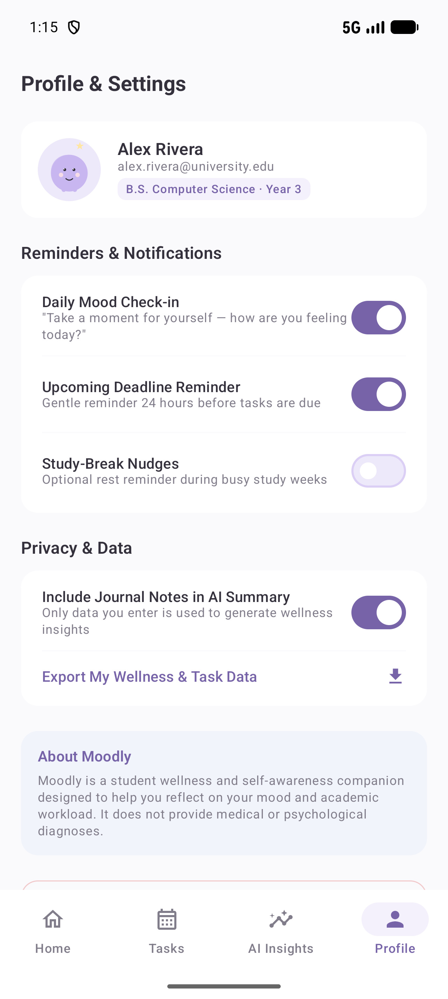

# Moodly

Moodly adalah aplikasi Android untuk mahasiswa yang menggabungkan tiga hal: mencatat mood harian, mengelola tugas kuliah, dan melihat perkiraan tingkat stres berdasarkan mood dan beban tugas. Maskotnya bernama **Momo**.

> Moodly adalah alat bantu refleksi diri, bukan alat diagnosis medis atau psikologis. Tingkat stres yang ditampilkan hanya perkiraan dari data yang kamu masukkan sendiri.

<p align="center">
  
  
  
</p>

## Fitur

- **Welcome & Login**: layar pembuka dengan Momo dan form login.
- **Home**: sapaan, mood hari ini, ringkasan stres, tugas terdekat, dan tombol cepat.
- **Daily Check-in**: pilih 1 dari 6 mood, rating 1–5, faktor penyebab, dan catatan jurnal opsional.
- **Tasks**: tambah, edit, tandai selesai, dan filter tugas (To Do, In Progress, Completed) dengan prioritas dan deadline.
- **AI Insights**: perkiraan tingkat stres mingguan, tren mood, kemungkinan penyebab stres, dan saran langkah kecil.
- **Mood History**: tren 7 hari, tren stres, kalender check-in, dan riwayat check-in.
- **Profile**: info pengguna, pengaturan pengingat, dan privasi.

## Tech stack

- Kotlin + Jetpack Compose (Material 3). UI ditulis di file `.kt`, tidak memakai layout XML.
- Arsitektur MVVM dengan Unidirectional Data Flow (UI → ViewModel → Repository → Room).
- Hilt untuk dependency injection.
- Room Database untuk penyimpanan lokal (offline).
- Navigation Compose dengan route type-safe (`@Serializable`).
- Kotlin Coroutines & Flow.
- Gradle Kotlin DSL + Version Catalog (`gradle/libs.versions.toml`).

| | Versi |
|---|---|
| Android Gradle Plugin | 8.7.2 |
| Gradle | 8.11.1 (lewat wrapper) |
| Kotlin | 2.0.21 |
| compileSdk / targetSdk | 35 |
| minSdk | 26 (Android 8.0) |

## Yang perlu disiapkan

1. **Android Studio** versi terbaru: https://developer.android.com/studio
2. **JDK 17 atau 21** untuk menjalankan Gradle. Lihat bagian [Atur Gradle JDK](#2-atur-gradle-jdk).
3. **Android SDK Platform 35**. Android Studio biasanya menawarkan untuk download otomatis saat sync.
4. Koneksi internet untuk build pertama (download Gradle dan library).

## Cara buka dan jalankan di Android Studio

### 1. Clone dan buka project

```bash
git clone https://github.com/Chriswk21/moodly.git
```

Di Android Studio: **File → Open**, lalu pilih folder `moodly` hasil clone (folder yang berisi `settings.gradle.kts`). Tunggu sampai **Gradle Sync** selesai. Build pertama bisa makan beberapa menit.

### 2. Atur Gradle JDK

Gradle 8.11.1 hanya bisa jalan dengan JDK 17 sampai 23. Beberapa versi Android Studio terbaru membawa JDK 25. Dengan JDK 25, sync bisa gagal atau diam tanpa pesan error.

1. Buka **File → Settings → Build, Execution, Deployment → Build Tools → Gradle** (di macOS: **Android Studio → Settings**).
2. Di **Gradle JDK**, pilih JDK 17 atau 21. Kalau belum ada, pilih **Download JDK…** lalu pilih versi 21.
3. Klik **OK**, lalu **File → Sync Project with Gradle Files**.

### 3. Siapkan emulator atau HP

**Emulator:**
1. Buka **Tools → Device Manager**.
2. Klik **+ → Create Virtual Device**, pilih misalnya **Pixel 8**, lalu pilih system image API 35 dan klik **Finish**.

**HP Android sungguhan:**
1. Di HP, buka **Settings → About phone**, lalu ketuk **Build number** 7 kali untuk mengaktifkan Developer options.
2. Buka **Developer options**, lalu aktifkan **USB debugging**.
3. Colokkan HP ke laptop dan izinkan debugging saat muncul pop-up.

### 4. Run

Pilih konfigurasi **app** dan device di toolbar atas, lalu klik tombol **Run ▶** (atau `Shift + F10`). Aplikasi akan ter-install dan terbuka otomatis.

Di layar login, isi email dan password apa saja. Login masih simulasi (lihat [Status](#status)).

## Build dari terminal

Pastikan `JAVA_HOME` mengarah ke JDK 17 atau 21.

```bash
# Windows
gradlew.bat assembleDebug

# macOS / Linux
./gradlew assembleDebug
```

APK hasil build ada di `app/build/outputs/apk/debug/app-debug.apk`. Untuk langsung install ke device yang terhubung, jalankan `installDebug`.

## Melihat tampilan tanpa menjalankan app

Setiap layar punya fungsi `@Preview`. Buka salah satu file `...Screen.kt`, lalu klik **Split** atau **Design** di pojok kanan atas editor.

## Struktur project

```
app/src/main/java/com/moodly/app/
├── data/
│   ├── local/          # Room: database, DAO, entity
│   └── repository/     # MoodRepository, TaskRepository
├── di/                 # Modul Hilt (database, dispatcher)
├── domain/
│   ├── model/          # Mood, Task, StressLevel, User
│   └── usecase/        # EstimateStressLevel (rumus perkiraan stres)
├── navigation/         # Route type-safe
└── ui/
    ├── components/     # MomoMascot, bottom navigation
    ├── screens/        # Satu folder per layar (Screen + ViewModel)
    └── theme/          # Warna, tipografi, bentuk
```

## Status

Yang sudah jalan: semua layar di atas, penyimpanan mood dan tugas di database lokal, dan perkiraan stres yang sama di Home dan AI Insights.

Yang belum:

- **Backend**: data hanya disimpan di HP (Room). Belum ada server atau sinkronisasi.
- **Login**: masih simulasi, semua email dan password diterima. Sign Up memakai form yang sama, dan "Forgot password?" belum berfungsi.
- **AI**: insight masih berbasis aturan (rule-based), belum memakai model AI seperti Gemini.
- **Profile**: pengaturan pengingat belum tersimpan, notifikasi belum dibuat, dan tombol Export belum berfungsi.
- **Tasks**: tombol "Schedule Agenda" belum mengganti tampilan.
- **Mood History**: kalender baru menampilkan tanggal 1–21.

## Troubleshooting

| Masalah | Solusi |
|---|---|
| Sync gagal atau diam tanpa error | Ganti Gradle JDK ke 17 atau 21 (langkah 2). |
| `SDK location not found` | Buka project lewat Android Studio supaya `local.properties` dibuat otomatis, atau buat file itu berisi `sdk.dir=<path Android SDK kamu>`. |
| `Failed to find target android-35` | Buka **Tools → SDK Manager**, lalu install **Android 15 (API 35)**. |
| Device tidak muncul | Cek kabel dan USB debugging, atau jalankan emulator dari Device Manager dulu. |
